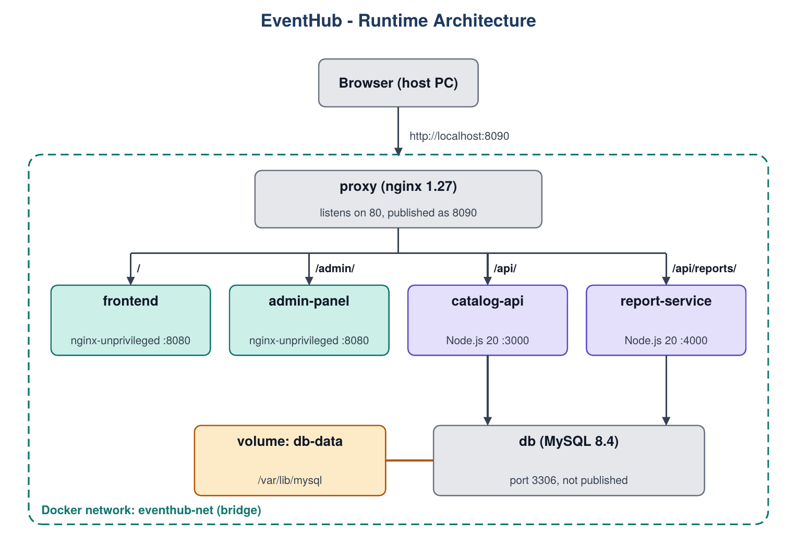

# EventHub - School Event Registration

Containerized event registration system with a Jenkins CI/CD pipeline (SYSIN final project).
Students browse school events (conferences, seminars, workshops), register through a short form and get notified when approved. The admin manages events, approves or rejects registrations and views a summary report.



## Modules (each in its own container)
| Container | Tech | Role |
|---|---|---|
| proxy | nginx 1.27 | Single public entry point (host port 8090 -> container port 80) |
| frontend | Vanilla JS/HTML/CSS on nginx | Student site: events, sign-up/login, registration form, My Event Registrations, notifications |
| admin-panel | Vanilla JS/HTML/CSS on nginx | Admin site: dashboard and report, event CRUD, approve/reject |
| catalog-api | Node.js 20 (no framework) | Auth, events, registrations, approval rules, notifications |
| report-service | Node.js 20 | `GET /reports/summary` (admin only) |
| db | MySQL 8.4 | Named volume `db-data`, not published |

## Ports
| URL | What |
|---|---|
| http://localhost:8090 | EventHub (student site) |
| http://localhost:8090/admin/ | Admin panel |
| http://localhost:8080 | Jenkins |

## Run locally
```bash
cp .env.example .env      # edit the passwords
docker compose up -d --build
```
Open http://localhost:8090. The admin account is created on first start from `ADMIN_EMAIL` / `ADMIN_PASSWORD` in `.env`.
Note: a manual build shows `Build dev` in the footer. Builds made by Jenkins show the real build number.

## Jenkins setup
1. `cd infra/jenkins && docker compose up -d --build`, then open http://localhost:8080 and unlock Jenkins with the initial admin password.
2. Install the suggested plugins (the GitHub and Mailer plugins are used for the webhook and the email).
3. Add a credential: kind **Secret file**, ID `eventhub-env`, containing your real `.env`.
4. New Item -> Pipeline -> *Pipeline script from SCM* -> Git, repository URL, branch `*/main`, Script Path `Jenkinsfile`.
5. Run the job once manually so Jenkins registers the triggers and the `ROLLBACK_TAG` parameter.

### Triggers
- **GitHub webhook:** `githubPush()` starts a build within seconds of a push. Jenkins runs on localhost, so a tunnel is needed: `ngrok http 8080`. Set the Payload URL to `https://<ngrok-address>/github-webhook/` (content type `application/json`, push events) and set the same address as the Jenkins URL under Manage Jenkins > System. The free ngrok address changes on every restart, so update both.
- **Poll SCM (fallback):** `pollSCM('H/2 * * * *')` checks GitHub about every 2 minutes, so builds still start when the tunnel is off.

### Pipeline
Checkout -> Test -> Build Images -> Deploy -> Smoke Test. Tests run with `docker build --target test` (Node's built-in `node:test`). A `post` section sends an email on success or failure.

## Rollback
In Jenkins: **Build with Parameters**, enter the last good build number in `ROLLBACK_TAG`, and build. It redeploys that version without rebuilding. Or from a terminal:
```bash
TAG=<previous build number> docker compose up -d --no-build
```

## Tests
`cd catalog-api && npm test` and `cd report-service && npm test` (unit tests, no database needed).

## Team
| Member | Role |
| Barazon, Angelo P. | Project Lead / Scrum Master |
| Laxamana, Karl Kristian Kenneth N.  | DevOps / CI-CD |
| Villanueva, Martin M.  | Infrastructure |
| Barazon, Angelo P. | Backend and Database |
| Tanglao, Joshua Lawrance S.  | Frontend, QA and Documentation |